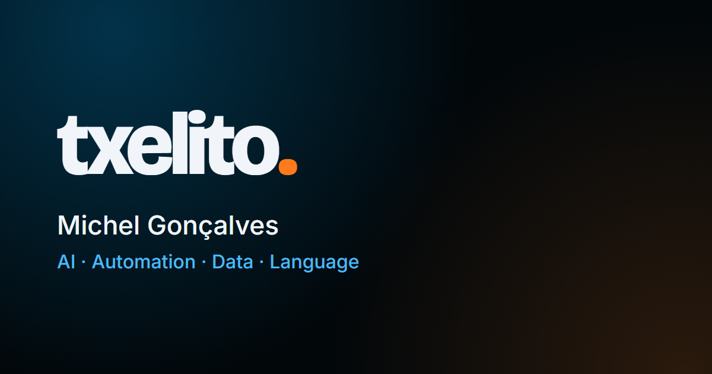

# Txelito.github.io

Portfólio de Michel Gonçalves: IA, automação, dados e linguagem.

**Site:** https://txelito.github.io (EN) · https://txelito.github.io/pt.html (PT)



## Como está organizado

| Ficheiro | Para que serve |
| --- | --- |
| `index.html` | Página em inglês |
| `pt.html` | Página em português. É uma cópia da inglesa: qualquer alteração tem de ser feita nas duas |
| `styles.css` | Todos os estilos |
| `script.js` | Modos, menu, cofre, mapas e animações |
| `assets/` | Imagens, certificados, CV e o cofre encriptado |
| `tools/vault.py` | Gera o cofre encriptado |

Não há passo de build. O GitHub Pages publica o que estiver no ramo `main`.

## Modos

O site tem três vistas: **Profissional**, **Académico** e **Pessoal**. Cada elemento com
`data-mode="pro"`, `data-mode="academic"` ou `data-mode="personal"` só aparece nesse modo.
Aceita vários valores, por exemplo `data-mode="pro academic"`. Um elemento sem `data-mode`
aparece sempre.

Para abrir o site diretamente num modo, usa `?v=pro`, `?v=academic` ou `?v=personal`.

## EN e PT em sintonia

As duas páginas são cópias separadas. Depois de mexer numa, confirma que a outra ficou com a
mesma estrutura:

```bash
python tools/check_sync.py
```

O script ignora os textos traduzidos e aponta a linha de cada diferença.

## Modo Pessoal (fechado por agora)

O modo Pessoal mostra só um painel "em construção". O cofre encriptado foi retirado do site:
`assets/vault.json` já não é publicado e a pergunta de acesso deixou de existir.

O código para o reabrir continua cá (`tools/vault.py` e a secção "PERSONAL VAULT" do
`script.js`). Para o reativar é preciso repor no HTML o formulário com os ids `vaultGate`,
`vaultUnlockForm`, `vaultPassphrase`, `vaultContent` e `vaultBody` (estão no histórico do git)
e voltar a gerar o cofre. Usa só frases aleatórias criadas com `vault.py new`, nunca uma
resposta que se possa adivinhar.

O texto original fica em `vault-src/`, que está no `.gitignore` e nunca deve ser publicado.

```bash
pip install cryptography pillow
python tools/vault.py            # volta a encriptar vault-src/ para assets/
python tools/vault.py new NOME   # cria uma frase de acesso para NOME
```

Para retirar o acesso a alguém, apaga a linha dessa pessoa em `vault-src/passphrases.txt` e
corre o script outra vez.

## Ver o site no computador

```bash
python -m http.server 8000
```

Depois abre http://localhost:8000. Abrir o `index.html` diretamente também funciona, mas o
cofre só abre através de um servidor.

## Imagens

As imagens do site estão em WebP, já no tamanho em que são mostradas. Ao adicionar uma nova,
reduz-a primeiro e põe `width`, `height` e `loading="lazy"` na tag ``.
